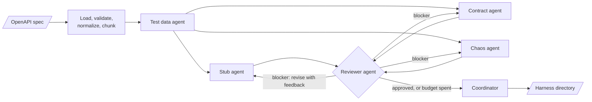
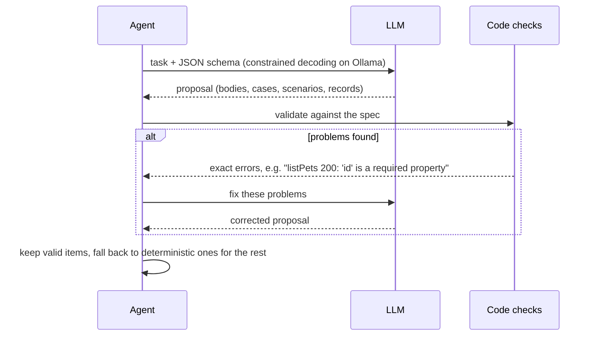
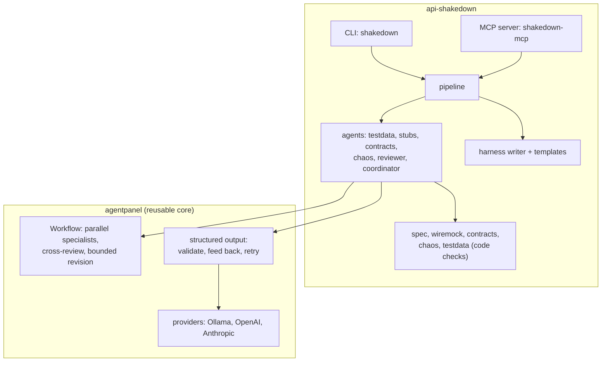

# API Shakedown

<!-- mcp-name: io.github.anzar-ahsan-commits/api-shakedown -->

**Give it an OpenAPI spec. Get back a ready-to-run test harness: WireMock stubs, contract
tests, robustness probes, and chaos scenarios, written by a team of LLM agents that
review each other's work.**

[](https://github.com/anzar-ahsan-commits/api-shakedown/actions/workflows/ci.yml)
[](https://pypi.org/project/api-shakedown/)
[](https://pypi.org/project/api-shakedown/)
[](https://github.com/anzar-ahsan-commits/api-shakedown/blob/main/LICENSE)

Runs **locally on [Ollama](https://ollama.com) by default**: no API key, no data leaves
your machine. Cloud models (OpenAI, Anthropic) are bring-your-own-key. Available as a
CLI, a Docker image, and an **MCP server** so an AI assistant can drive it.

> Status: alpha (0.1.1). Works end to end on the example spec with a local 8B model.


*A real run on the bundled example with `qwen3:8b` on a laptop, sped up: generation
took about 9 minutes. Recording: [docs/demo.cast](https://github.com/anzar-ahsan-commits/api-shakedown/blob/main/docs/demo.cast).*

---

## Contents

- [Why](#why)
- [Quick start](#quick-start)
- [What you get](#what-you-get)
- [How it works](#how-it-works)
- [Install](#install)
- [Usage](#usage)
- [Configuration](#configuration)
- [MCP server](#mcp-server)
- [Docker](#docker)
- [Architecture](#architecture)
- [Limitations](#limitations)
- [Roadmap](#roadmap)
- [Development](#development)
- [Contributing](#contributing)
- [License](#license)

## Why

Teams that consume an API need three things that are tedious to write by hand and go
stale quickly:

1. **A realistic mock** of the API to develop and test against.
2. **Contract tests** that tell you when the real API stops matching its spec.
3. **Failure drills**: what does your client do when the API is slow, flaky, rate
   limited, returns garbage, or goes down?

API Shakedown generates all three from the spec you already have, and keeps them honest:
**the LLMs never write code that runs**. They propose *data* (response bodies, test
cases, failure scenarios, test records), and code validates every item against the
spec, feeds problems back to the model, and falls back to deterministic output when a
model cannot get it right. Without any model at all (`--offline`), every part still works.

## Quick start

Prerequisites: Python 3.11+, Docker (for WireMock), and [Ollama](https://ollama.com) with
a model (`ollama pull qwen3:8b`) unless you use `--offline` or a cloud model.

```bash
pip install api-shakedown
shakedown doctor                                   # is the model ready?
shakedown run openapi.yaml --out my-harness        # minutes on a local model
cd my-harness
docker compose up -d                               # WireMock with your stubs on :8080
pip install -r requirements.txt
SHAKEDOWN_SELECT_STATUS=1 pytest tests/test_contract.py
python chaos/chaos.py on flaky-start               # now point your client at :8080
python chaos/chaos.py off
```

Try it on the bundled example: `shakedown run examples/petstore.yaml --out petstore`.

A real run on the example spec with `qwen3:8b`:

```text
Petstore 1.0.0: 5 operations (ollama / qwen3:8b)
Generating test data...
Test data ready (3 Pet).
Generating stubs, contract tests, and chaos scenarios...
  stubs: done
  contracts: done
  chaos: done
  review contracts: approved
  review stubs: approved
  review chaos: approved

Wrote 14 files to harness in 436s: 15 stubs, 11 contract cases, 11 chaos scenarios, 30 probes.
Next: cd harness && docker compose up -d   (then see README.md)
```

## What you get

```text
my-harness/
├── README.md                  # generated: how to run it, every scenario, review notes
├── docker-compose.yml         # WireMock 3 serving the stubs (port: SHAKEDOWN_WIREMOCK_PORT)
├── wiremock/mappings/         # stub mappings
├── tests/
│   ├── test_contract.py       # contract tests (cases in contract_cases.json)
│   └── test_robustness.py     # malformed-request probes (cases in robustness_cases.json)
├── chaos/
│   ├── chaos.py               # switch failure scenarios on/off (standard library only)
│   └── chaos_scenarios.json
├── data/dataset.json          # test records and edge-case values per field
├── requirements.txt           # pytest, httpx, openapi-schema-validator
└── shakedown.json             # manifest: counts, review outcome, generation notes
```

| Part | What it does |
|---|---|
| **Stubs** | Every documented response of every operation. Known ids return their own record, unknown ids return the documented 404, and any other response can be requested with `X-Shakedown-Status: <status>`. |
| **Contract tests** | Happy paths, documented error statuses, and boundary values. Each checks the status code, `Content-Type`, and the body against the response schema. Run them against the stubs or a real deployment. |
| **Robustness probes** | Invalid bodies and parameters derived from the schemas (missing required fields, wrong types, out-of-range values, broken JSON). A robust server answers 4xx, never 5xx. |
| **Chaos scenarios** | Seven baseline failures every client should survive, plus scenarios the LLM targets at your API. |
| **Test data** | Realistic, consistent records per entity, shared by the stubs and the tests, plus edge-case values for every field. |

Baseline chaos scenarios:

| Scenario | What happens | A resilient client should |
|---|---|---|
| `total-outage` | Every endpoint returns 503 | Fail fast, back off, not hammer the API |
| `slow-responses` | Every response takes 3 s | Stay responsive |
| `timeouts` | Every response takes 30 s | Give up on its own and free resources |
| `connection-resets` | Connections are reset | Retry idempotent calls with backoff |
| `flaky-start` | First 2 calls fail with 503, then recover | Retry and succeed on the third attempt |
| `rate-limited` | First 3 calls return 429 | Honour `Retry-After` |
| `truncated-json` | Success bodies are cut off mid-JSON | Report a parse error, never crash |

LLM-targeted scenarios from a real run include *createPet fails 3 times with 503 then
recovers*, *listPets is rate limited*, and *getPet loses required fields*.

## How it works



1. **Spec layer**: loads YAML/JSON from a path or URL, validates it (problems become
   warnings), inlines `$ref`s safely, and splits operations into prompt-sized chunks so
   large specs fit small models.
2. **Test data agent** runs first: the stubs and tests share its records.
3. **Stub, contract, and chaos agents** run in parallel.
4. **Reviewer** judges each artifact. Blockers send it back to its author with the
   feedback, for a bounded number of rounds; suggestions are kept as notes.
5. **Coordinator** assembles the harness and its README, including anything the
   reviewer still rejected when the revision budget ran out.

Every agent follows the same pattern, which is what keeps small local models reliable:



Things code guarantees, so the model never has to:

- Request matching, URL patterns, priorities, and path-parameter types in the stubs.
- Response bodies valid against their schemas.
- Test inputs that route (valid path parameters, required query parameters), success
  cases that use ids that exist, 404 cases that use ids that do not.
- Authentication from the spec's security schemes.
- Chaos scenarios that are internally consistent (a "flaky" failure must recover, a rate
  limit is a 429, a partial outage leaves some endpoints up).
- Reviewer findings that cite real items, and blockers only on what the author controls.

## Install

```bash
pip install api-shakedown              # local models via Ollama; includes the MCP server
pip install "api-shakedown[cloud]"     # plus OpenAI and Anthropic
```

Or use the Docker image, which includes everything: see [Docker](#docker).

Generated harnesses need Docker (for WireMock) and Python for their tests.

## Usage

```text
shakedown doctor                     Check the LLM provider is reachable and ready
shakedown inspect SPEC [--json]      Show the operations the agents will see
shakedown run SPEC [options]         Generate a harness
shakedown version
```

`shakedown run` options:

| Option | Default | |
|---|---|---|
| `--out PATH` | `shakedown-output` | Where to write the harness (refuses a non-empty directory) |
| `--offline` | off | No LLM: deterministic output in seconds |
| `--no-review` | review on | Skip the reviewer (about 3x faster on the example) |
| `--max-revisions N` | `1` | Review/revise rounds |
| `--force` | off | Write into a non-empty directory (only overwrites harness files) |
| `--provider`, `--model` | from settings | Override the LLM for this run |

Using the harness:

```bash
docker compose up -d                                     # stubs on http://localhost:8080
SHAKEDOWN_SELECT_STATUS=1 pytest tests/test_contract.py  # against the stubs
python chaos/chaos.py list | on <scenario> | off         # failure drills
SHAKEDOWN_TARGET_URL=https://api.example.com/v1 pytest tests   # against a real server
```

PowerShell: `$env:SHAKEDOWN_SELECT_STATUS = "1"; pytest tests/test_contract.py`.

## Configuration

Settings come from environment variables or a `.env` file
(see [.env.example](https://github.com/anzar-ahsan-commits/api-shakedown/blob/main/.env.example)). Everything is optional.

| Variable | Default | |
|---|---|---|
| `SHAKEDOWN_PROVIDER` | `ollama` | `ollama`, `openai`, or `anthropic` |
| `SHAKEDOWN_MODEL` | per provider | `qwen3:8b`, `gpt-5-mini`, `claude-sonnet-5-5` |
| `SHAKEDOWN_OLLAMA_URL` | `http://localhost:11434` | Where Ollama runs |
| `SHAKEDOWN_BASE_URL` | | Endpoint override, e.g. an OpenAI-compatible server |
| `SHAKEDOWN_TIMEOUT` | 600 (Ollama) / 120 | Seconds per request |
| `SHAKEDOWN_CONTEXT_WINDOW` | `16384` | Ollama context size |
| `SHAKEDOWN_REASONING` | model default | Ollama: turn a reasoning model's thinking on/off |
| `SHAKEDOWN_AGENT_MODELS` | | Per-agent models, e.g. `{"reviewer": "anthropic:claude-sonnet-5-5"}` |
| `SHAKEDOWN_AGENT_REASONING` | thinking off for generators | Per-agent thinking, e.g. `{"reviewer": true}` |
| `OPENAI_API_KEY`, `ANTHROPIC_API_KEY` | | Bring your own key |

Mixing models works well: generate locally, review with a stronger cloud model:

```bash
SHAKEDOWN_AGENT_MODELS='{"reviewer": "anthropic:claude-sonnet-5-5"}' shakedown run openapi.yaml
```

Generated harnesses read `SHAKEDOWN_TARGET_URL`, `SHAKEDOWN_SELECT_STATUS`,
`SHAKEDOWN_API_KEY`, `SHAKEDOWN_BASIC_AUTH`, `SHAKEDOWN_TIMEOUT`, and
`SHAKEDOWN_WIREMOCK_PORT` / `SHAKEDOWN_WIREMOCK_URL`.

## MCP server

`shakedown-mcp` (stdio) lets an MCP client such as Claude Code or Claude Desktop
generate harnesses and run failure drills:

| Tool | |
|---|---|
| `doctor` | Is the LLM provider ready? |
| `inspect_spec` | List a spec's operations and warnings |
| `generate_harness` | Generate a harness, with progress notifications |
| `list_chaos_scenarios` | Scenarios in a harness |
| `activate_chaos` / `deactivate_chaos` | Switch a scenario on/off in a running WireMock |

```bash
claude mcp add api-shakedown -- uvx api-shakedown mcp     # Claude Code, nothing to install
claude mcp add api-shakedown -- shakedown-mcp             # Claude Code, after pip install
```

Name in the [official MCP Registry](https://registry.modelcontextprotocol.io):
`io.github.anzar-ahsan-commits/api-shakedown`.

Other clients (`mcpServers` in their config):

```json
{
  "mcpServers": {
    "api-shakedown": {
      "command": "uvx",
      "args": ["api-shakedown", "mcp"],
      "env": { "SHAKEDOWN_PROVIDER": "ollama" }
    }
  }
}
```

Pass absolute paths. Generating with a local model takes minutes; if your client gives up
on long tool calls, use `offline` or `review: false`, or raise its tool timeout.

## Docker

```bash
docker build -t api-shakedown .
docker run --rm -v "$PWD:/work" api-shakedown run /work/openapi.yaml --out /work/harness
docker run -i --rm -v "$PWD:/work" --entrypoint shakedown-mcp api-shakedown   # MCP server
```

The image reaches Ollama on the host at `host.docker.internal`. Details for Linux,
PowerShell, and cloud keys: [DOCKER.md](https://github.com/anzar-ahsan-commits/api-shakedown/blob/main/DOCKER.md).

## Architecture



The orchestration core is published separately as
[**agentpanel**](https://github.com/anzar-ahsan-commits/api-shakedown/blob/main/packages/agentpanel/README.md): a small, domain-agnostic library for
"specialists draft, reviewers critique, authors revise, a coordinator decides" workflows
on LangGraph. It never imports the application; a test enforces that.

```text
packages/agentpanel/     # the reusable core (its own PyPI package)
src/api_shakedown/       # the application
  spec/                  # loading, validation, $ref resolution, edge cases, samples
  agents/                # the six agents
  templates/             # runners copied into every harness
examples/petstore.yaml   # example spec
tests/                   # offline tests; `-m live` for Ollama + Docker tests
```

## Limitations

- **Speed on local models**: a full run on the 5-operation example takes about 7 minutes
  with `qwen3:8b`, most of it review; `--no-review` takes about 2.5 minutes.
- **Small reviewers are imperfect**: an 8B reviewer sometimes raises a false blocker,
  which costs a revision round. Use a stronger model for the reviewer if you can.
- **Specs**: OpenAPI 3.0-3.2. Swagger 2.0 must be converted first; references to other
  files are not followed; self-referencing schemas are not validated.
- **Stubs are static**: a create call returns a new record, but stubs do not keep state
  between calls.
- **Probes against stubs** only cover operations that document a 4xx; they are meant for
  real servers.
- Tested so far mainly on the bundled example. Reports from larger real-world specs are
  very welcome.

## Roadmap

- Larger real-world specs: batching and timing at 30+ operations
- Stateful stubs (WireMock response templating, created records visible to later calls)
- Auth-failure scenarios (401/403) and "valid but nasty input must not 5xx" probes
- Review of the test dataset
- More harness targets (k6 load profiles, Postman collections)

## Development

```bash
git clone https://github.com/anzar-ahsan-commits/api-shakedown.git
cd api-shakedown
python -m venv .venv && source .venv/bin/activate     # Windows: .venv\Scripts\activate
pip install -e packages/agentpanel -e ".[dev]"
ruff check . && ruff format --check . && mypy
pytest                 # offline: LLMs are faked, about 20 s
pytest -m live         # also uses your local Ollama and Docker
```

## Contributing

Contributions are welcome: see [CONTRIBUTING.md](https://github.com/anzar-ahsan-commits/api-shakedown/blob/main/CONTRIBUTING.md). Security issues:
see [SECURITY.md](https://github.com/anzar-ahsan-commits/api-shakedown/blob/main/SECURITY.md).

## License

[MIT](https://github.com/anzar-ahsan-commits/api-shakedown/blob/main/LICENSE) © 2026 Anzar Ahsan
